  

  

  
  
  
  
  

---

## About me

Hi, I'm Juan Pablo. I'm a full-stack developer from Mexico, and I like owning a feature from start to finish: the screen the user taps, the API behind it, the database, and getting it deployed.

Most of my backend work is in **Java with Spring Boot**, plus **.NET**, **NestJS** and **Node.js**. On the frontend I reach for **React / Next.js** or **Angular** with TypeScript. I've also built **Android apps in Kotlin**, cross-platform apps with **Flutter**, **PWAs** and **desktop apps**.

Lately I've been building **RAG** features with **ChromaDB** and Python, and I also enjoy building **Arduino / IoT** projects and small games in **Godot**.

I speak Spanish natively and English at a **B2** level, and I'm happy working remotely with distributed teams.

 

---

## What I work on

<table>
  <tr>
    <td width="25%" valign="top">
      <h4>Web apps</h4>
      Next.js, React or Angular frontends talking to RESTful APIs, with auth (JWT) and clean, reusable UI.
    </td>
    <td width="25%" valign="top">
      <h4>APIs &amp; backend</h4>
      RESTful APIs and services in Spring Boot, .NET and NestJS, as microservices or a well-structured monolith.
    </td>
    <td width="25%" valign="top">
      <h4>Mobile, desktop &amp; PWA</h4>
      Native Android with Kotlin, Flutter for cross-platform, installable PWAs and desktop apps.
    </td>
    <td width="25%" valign="top">
      <h4>AI, IoT &amp; games</h4>
      RAG with ChromaDB, Arduino-based IoT prototypes and 3D games in Godot Engine.
    </td>
  </tr>
</table>

---

## Architecture &amp; practices

  
  
  
  
  
  
  
  
  
  
  

I try to keep code easy to read and easy to change: clear layers, small focused classes, meaningful names and tests where they matter. I pick the architecture based on the project, not the hype. Sometimes that's microservices with CQRS, and sometimes a clean monolith is the right call.

---

## Tech stack

<h4 align="center">Languages</h4>

<h4 align="center">Frontend</h4>

  

<h4 align="center">Backend</h4>

<h4 align="center">Mobile &amp; desktop</h4>

<h4 align="center">Databases</h4>

 

<h4 align="center">AI</h4>

<h4 align="center">IoT &amp; game dev</h4>

<h4 align="center">DevOps &amp; tools</h4>

---

## GitHub stats

  

  

<h4 align="center">Contributions in the last year</h4>

  

---

## Featured projects

  
  
  
  
  
  

---

## Let's talk

  I'm looking for full-stack roles on remote teams, and I'm always up for a good side project. 
  The fastest way to reach me is LinkedIn or email.  
  
  

  

